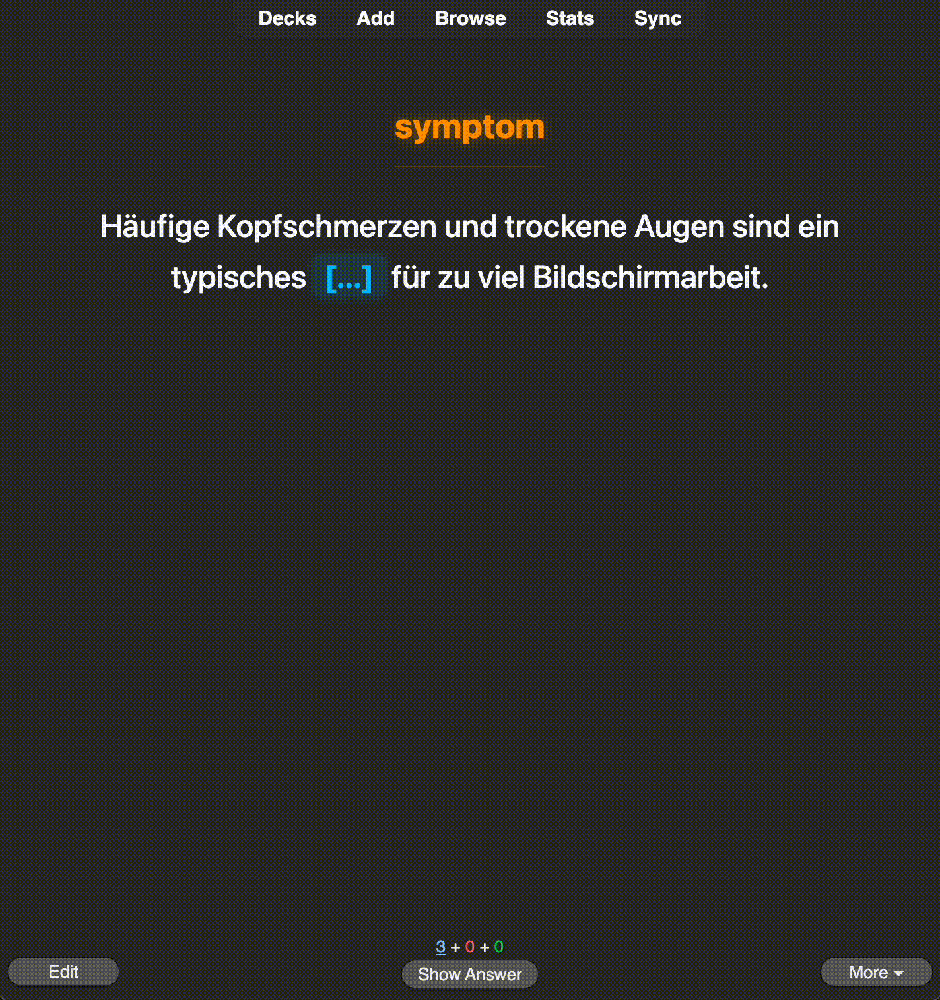
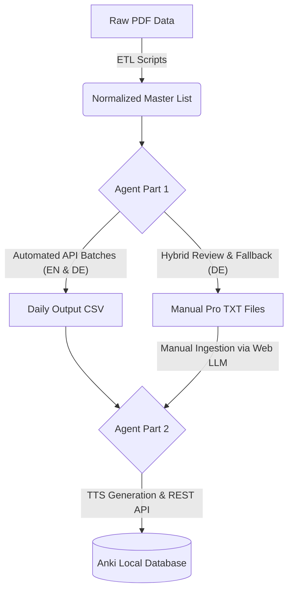

# 🧠 Anki-LLM-Pipeline: Automated Vocabulary Data Pipeline


<p align="center">
  
</p>

## Project Motivation

This project started from a personal frustration with building and maintaining Anki cards with web-based LLMs.
As a heavy Anki user, I wanted to automate the repetitive parts of that workflow without giving up control over the final data.

**The Problem:** Generating useful Anki cards with web-based LLMs works well for small batches, but becomes inefficient over time. Long chat sessions lose effectiveness as context grows, while reviewing, formatting, adding audio, and manually transferring cards into Anki creates repetitive work.

**The Solution:** An LLM-powered pipeline that extracts raw text, normalizes it, and asynchronously injects high-quality, TTS-enabled cloze cards directly into Anki's local database through AnkiConnect.

## ⚙️ Tech Stack
* **Language:** Python 3.10+
* **AI & NLP:** Google Gemini API (`gemini-3.8-flash`, `gemini-3.6-flash`, `(Web) Gemini Pro 3.1 High`)
* **Data Extraction:** PyMuPDF (fitz)
* **Media & Database:** Edge-TTS, AnkiConnect (Local REST API)
* **Anki Card UI:** HTML, CSS, Vanilla JavaScript (Regex-based DOM manipulation)

  
## System Design & Trade-offs

The initial goal was to automate the entire workflow end-to-end. During development, however, I found that fully automating every language required more capable models and substantially higher API usage than was practical for my use case. A strategic **Hybrid Architecture (Human-in-the-Loop)** was therefore adopted.

| Pipeline | Target Language | Model | Automation Level | Rationale |
| :--- | :--- | :--- | :--- | :--- |
| **English** | English | `Gemini 3.8 Flash (API)` | 100% Autonomous | Reliable enough for fully automated batch generation in my workflow. |
| **German** | German | `Gemini 3.6 Flash (API)` + `Gemini Pro (via Web)` | Hybrid | Combines automated daily API batches with Pro review & fallback, since German grammar (gendered articles, case declensions) benefits from stronger model reasoning and additional review to reduce subtle errors in Cloze cards. |

> **Data Quality & Accuracy > Blind Full-Automation.***



### Reliability & Fault Tolerance

* **Multi-Model Quota Isolation:** Distributes language pipelines across distinct model endpoints (`gemini-3.6-flash` for German, `gemini-3.8-flash` for English) to double daily Request capacity and prevent `RESOURCE_EXHAUSTED` bottlenecks.  
* **Exponential Backoff:** The system dynamically doubles wait times upon encountering API rate limits (429 errors), preventing server overload.
* **Stateful Processing:** Data queues are updated only after successful processing, allowing interrupted runs and failed API calls to resume without re-processing completed entries.

## 🎨 Anki Card UI Engine

The project also includes a pre-configured Anki card template (`/anki_template`) for rendering and formatting the generated cards.

* **Dynamic Colorization:** Utilizes JavaScript Regex within the Anki template to automatically color-code German articles upon rendering, enhancing cognitive retention.
* **HTML Fragment Merging:** A custom Python utility that merges fragmented HTML tags generated by the LLM so that cloze deletions remain valid and render correctly in Anki.
* **Asynchronous Audio:** Integrates Edge TTS into the pipeline to generate pronunciation audio automatically without manual recording.


## 🚀 Installation & Customization

### 1. Prerequisites

* Install [Anki](https://apps.ankiweb.net) and ensure it is running in the background.
* Install the [AnkiConnect](https://ankiweb.net/shared/info/2055492159) add-on (Code: `2055492159`) to enable the local REST API.

### 2. Environment Setup

Clone the repository and install dependencies:

```bash
git clone https://github.com/onuross/anki-llm-pipeline.git
cd anki-llm-pipeline
pip install -r requirements.txt

```

Rename the `.env.example` file to `.env` and securely add your Google Gemini API key.

### 3. Customization (i18n Supported)

* **Dynamic Localization:** The system supports dynamic prompt injection. Change the `base_language` (e.g., to "English", "Turkish", "Spanish") in the Python configurations to dynamically alter the explanation and translation languages of the generated cards.

### 4. Execution

```bash
# Step 1: Mine and normalize data from PDFs (Legacy Data Mining)
# Note: These ETL scripts function reliably as foundational layers but may require minor path adjustments for custom unstructured datasets.
python etl_data_mining/phase1_pdf_extractor.py
python etl_data_mining/phase2_normalizer.py
python etl_data_mining/phase3_deduplication.py

# Step 2: Enrich words and generate flashcards via LLM
python src/part_1.py

# Step 3: Generate TTS Audio and inject into Anki
python src/part_2.py
```

## Automation & Daily Workflow (Cron & Aliases)

The pipeline decouples resource-heavy generation from database synchronization, enabling scheduled background processing alongside on-demand injection:

1. **Autonomous Background Batching (Part 1):** Scheduled via a system daemon (`cron` on Linux or `launchd` on macOS) to execute daily at 13:00. It processes API-driven English cards and stages German Pro demand files directly on the Desktop.
2. **On-Demand Database Sync (Part 2):** Because Anki must be active locally to accept REST payloads via AnkiConnect, injection remains an intentional, on-demand step.

Add these custom aliases to your shell configuration (`~/.zshrc` or `~/.bashrc`):

```bash
alias ankigen="/path/to/venv/bin/python /path/to/anki-llm-pipeline/src/part_1.py"
alias ankipush="/path/to/venv/bin/python /path/to/anki-llm-pipeline/src/part_2.py"
```

Reload your shell environment (`source ~/.zshrc`). The main workflow can be triggered directly from the shell:

* `ankigen` ➔ Triggers daily batch processing and stages fallback prompts on demand.
* `ankipush` ➔ Generates Edge-TTS neural audio, injects flashcards into Anki via REST API, appends records to master datasets, and statefully flushes temporary queues.

### ⚙️ System Automation (macOS Background Daemon)

To achieve near-zero-touch background automation, Part 1 can be registered as a background service via macOS `launchd`. Since Part 1 isolates the automated routines from the human-in-the-loop Pro review, Part 2 is intentionally reserved for user-triggered execution once Anki is running.

Create the configuration file `com.user.ankibot.plist` in `~/Library/LaunchAgents/`:


```xml
<?xml version="1.0" encoding="UTF-8"?>
<!DOCTYPE plist PUBLIC "-//Apple//DTD PLIST 1.0//EN" "http://www.apple.com/DTDs/PropertyList-1.0.dtd">
<plist version="1.0">
<dict>
    <key>Label</key>
    <string>com.user.ankibot</string>

    <key>ProgramArguments</key>
    <array>
        <!-- Path to your virtual environment Python binary -->
        <string>/path/to/your/virtualenv/bin/python</string>
        <!-- Path to your main pipeline script -->
        <string>/path/to/your/project/src/part_1.py</string>
    </array>

    <key>WorkingDirectory</key>
    <string>/path/to/your/project</string>

    <key>StartCalendarInterval</key>
    <dict>
        <key>Hour</key>
        <integer>13</integer>
        <key>Minute</key>
        <integer>0</integer>
    </dict>

    <key>StandardOutPath</key>
    <string>/tmp/ankibot_output.log</string>
    <key>StandardErrorPath</key>
    <string>/tmp/ankibot_error.log</string>
</dict>
</plist>
```

Load and start the daemon with:

```bash
launchctl load -w ~/Library/LaunchAgents/com.user.ankibot.plist
```


## 🗺️ Future Roadmap
- [ ] **External Configuration:** Migrate hardcoded Python dictionaries to a modular `config.yaml` for easier user customization.
- [ ] **Dead Letter Queue (DLQ):** Implement a robust DLQ logic for malformed LLM JSON outputs to ensure zero-word-loss during heavy hallucinations.
- [ ] **Event-Driven Architecture:** Introduce a `watchdog` File Watcher to trigger the ETL pipeline automatically the moment a new PDF is dropped into the data folder.
- [ ] **Web GUI:** Develop a lightweight Streamlit interface for non-technical users.
